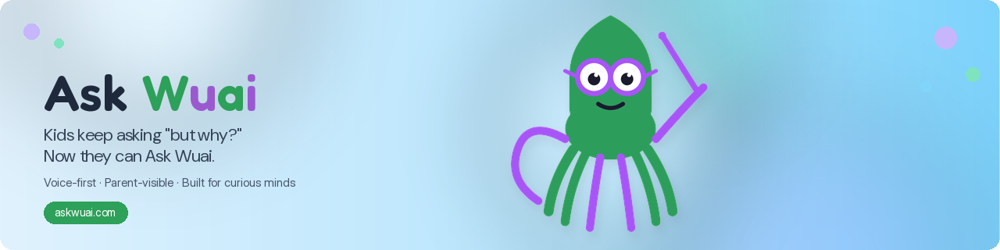
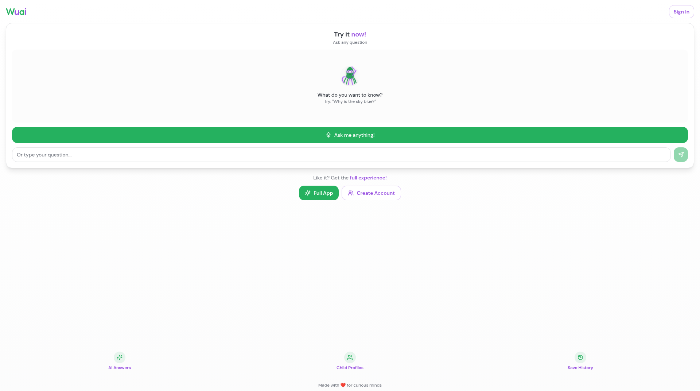
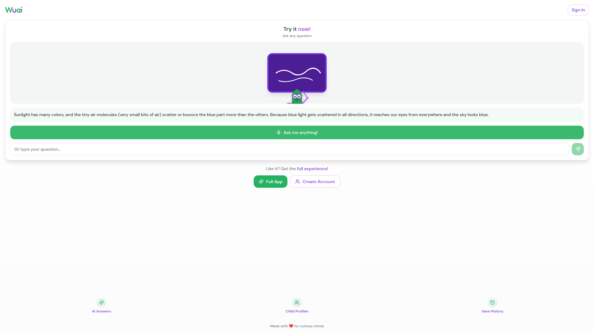

<p align="center"></p>

<p align="center">
[](LICENSE)
[](https://www.typescriptlang.org/)
[](https://react.dev/)
[](https://vitejs.dev/)
[](https://supabase.com/)
[](https://askwuai.com)
</p>

# Little Thinker AI (Wuai)

**Wuai** is a mobile-first children’s learning app for ages roughly 3–12. Kids ask questions by voice or text and get age-appropriate spoken answers with educational images. Parents manage child profiles, settings, and screen-time limits.

> **Live demo:** [https://askwuai.com](https://askwuai.com)  
> **In-app technical docs (hosted):** [https://askwuai.com/documentation.html](https://askwuai.com/documentation.html)

Built with **Lovable** + **Supabase** (Auth, Postgres, Edge Functions). The frontend is a React + Vite SPA; paid AI / TTS / STT calls run only in Deno Edge Functions so provider secrets never sit in the browser.

---

## Screenshots

| Landing | Answered question |
| --- | --- |
|  |  |

---

## Features

- **Voice + text Q&A** — speech recognition / Whisper transcription, typed fallback
- **Age-aware answers** — prompts adjust complexity for the child’s age band
- **Spoken replies** — native speech synthesis plus premium ElevenLabs voices
- **Educational media** — AI-generated images (and Unsplash support) alongside answers
- **Multi-child profiles** — parent-managed children, preferences, and history
- **Parent controls** — PIN-gated settings, voice selection, sand timer / screen time
- **Auth** — email/password and OAuth via Supabase Auth
- **Conversational follow-ups** — “Why?” / “Tell me more” keep context

---

## Stack

| Layer | Technology |
| --- | --- |
| Frontend | TypeScript, React 18, Vite, Tailwind CSS, shadcn/ui |
| Backend | Supabase (Auth, Postgres, Edge Functions on Deno) |
| AI | Lovable AI Gateway (Gemini family + fallbacks), optional Perplexity |
| Voice | OpenAI Whisper (transcribe), ElevenLabs TTS |
| Media | Edge `generate-image` / `media` / `unsplash` functions |
| Hosting | Vercel (`askwuai.com`) + Supabase |

---

## Architecture

```
Browser (React SPA)
    │  anon / user JWT only
    ▼
Supabase
    ├── Auth + Postgres
    └── Edge Functions (Deno)
            │  secret API keys from function env
            ▼
         Lovable AI / Whisper / ElevenLabs / Unsplash
```

Edge functions in this repo: `answer`, `articulate`, `media`, `generate-image`, `unsplash`, `transcribe`, `elevenlabs-tts`.

---

## Local setup

1. Create a Supabase project; note the project URL and **anon / publishable** key.
2. Clone this repository.
3. Install dependencies (`npm install`; `bun.lockb` is also present if you prefer Bun).
4. Copy `.env.example` → `.env` and fill in your Supabase URL / anon key / project ref. **Do not commit `.env`.**
5. Deploy the Edge Functions and set secrets in the Supabase dashboard (or CLI) for the provider keys listed below.
6. `npm run dev` — open the Vite URL, create a test account, and try chat / voice.

```sh
cp .env.example .env
npm install
npm run dev
```

---

## Environment variables (names only)

### Client (Vite)

| Name | Purpose |
| --- | --- |
| `VITE_SUPABASE_URL` | Supabase project URL |
| `VITE_SUPABASE_PUBLISHABLE_KEY` | Supabase anon / publishable key |
| `VITE_SUPABASE_PROJECT_ID` | Supabase project ref (tooling / config) |

### Edge Function secrets (never commit)

| Name | Purpose |
| --- | --- |
| `LOVABLE_API_KEY` | Lovable AI Gateway (answers, media, images) |
| `PERPLEXITY_API_KEY` | Optional answer provider |
| `OPENAI_API_KEY` | Whisper transcription |
| `ELEVENLABS_API_KEY` | Premium TTS |
| `UNSPLASH_ACCESS_KEY` | Stock image search |
| `NANO_BANANA_API_KEY` | Optional alternate image provider (see `NANO_BANANA_API_SETUP.md`) |

Also set `project_id` in `supabase/config.toml` to **your** project ref (placeholder in this tree: `YOUR_PROJECT_REF`).

---

## Project structure

```
askwuai/
├── src/                 # React / Vite application
├── supabase/
│   ├── config.toml
│   ├── functions/       # Deno Edge Functions
│   └── migrations/
├── docs/screenshots/    # README screenshots
├── DOCUMENTATION.md     # Full technical narrative
├── CODEBASE_OVERVIEW.md
├── .env.example
└── public/documentation.html
```

---

## Project status

Live product at [askwuai.com](https://askwuai.com). Early consumer / incubator demo: expect ongoing UX and backend hardening. Known gaps (JWT verification off on several functions, no rate limits, open `proxy-image` on the `development` branch) are tracked separately and are **not** addressed in this docs pass.

---

## More from Daniel

- Public LMS writing prototype (source): [github.com/dlealvilla/lms_ai](https://github.com/dlealvilla/lms_ai)

---

## License

TODO — choose and add a license file before treating this as a formal open-source release.
